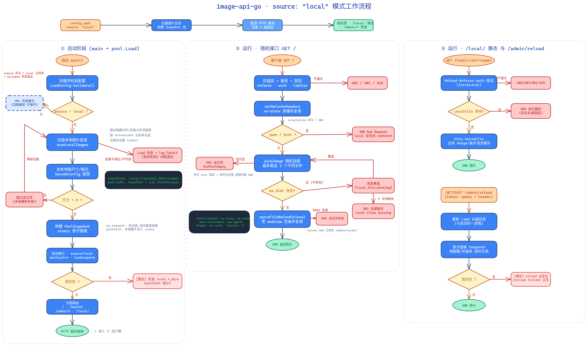

# 开发指南

## 1. 目标与约束

本项目的开发应始终遵循以下原则：

- 以 Go 标准库为主，避免引入重型框架
- 保持单二进制、无数据库、零外部依赖服务的定位
- 图片本体默认不经过 API 服务，服务只负责选择和返回地址；`source: local` 时例外，本地文件由服务直接返回
- 代码实现尽量简单、直接、可维护

## 2. 开发环境

### 2.1 前置要求

- Go 1.25 或更高版本（`golang.org/x/image` 安全修复要求）
- 终端环境可访问网络（用于拉取依赖）
- 运行 e2e 套件需要 Python 3（仅标准库）

### 2.2 运行目录说明

Go 模块根目录为 src/。因此：

```bash
cd src
go build ./...
go test ./...
```

若从项目根目录直接运行，会导致配置文件和 URL 列表路径解析错误。

## 3. 常用开发命令

```bash
# 在 src/ 目录内执行
cd src

go build ./...      # 编译
go test ./...       # 单元测试
go vet ./...        # 静态检查
gofmt -l .          # 格式检查（无输出即通过）
go test -race ./... # 竞态检测
```

## 4. 代码结构

| 目录/文件 | 说明 |
|---|---|
| src/main.go | 服务入口，启动 HTTP Server |
| src/app/router.go | HTTP 路由组装（含 base_path 挂载） |
| src/app/handler.go | 随机图片与本地静态访问处理 |
| src/app/admin.go | 健康检查与管理端点 |
| src/app/auth.go | Token 鉴权与防盗链 |
| src/app/pool.go | URL 池核心、metadata 预取与后台补抓 |
| src/app/urllist.go | URL 列表文件读取与去重 |
| src/app/localscan.go | 本地图片目录扫描与路由生成 |
| src/app/localfile.go | 本地文件安全打开（防符号链接替换） |
| src/app/config.go | 配置加载、默认值与校验 |
| src/app/cache.go | metadata 缓存持久化 |
| src/app/ratelimit.go | 全局限流 |
| src/app/imageinfo.go | 图片元数据探测 |
| src/app/recent.go | 最近访问追溯 |
| src/app/logging.go | 结构化日志与脱敏 |
| src/app/util.go | HTTP/格式化通用工具 |
| test/ | 端到端测试（见第 6 节） |
| tools/ | 辅助脚本（批量转换、WebP 转换，各目录含独立 README） |

## 5. 本地图源（source: local）流程

启动扫描、请求处理与异常分支的完整流程见下图（可编辑源文件：[local-mode-flow.excalidraw](local-mode-flow.excalidraw)，图片：[local-mode-flow.png](local-mode-flow.png)，可用 [Excalidraw](https://www.excalidraw.com) 打开修改）：



图中几处与实现强相关的约定：

- **扫描**：目录内递归遍历，跳过隐藏文件、隐藏子目录与所有符号链接（文件链接不读取、目录链接不进入，避免把配置目录外的内容纳入白名单）；扩展名按 `local.extensions` 白名单匹配（不区分大小写），跨方向目录用 `seen` 去重；单文件解码失败只跳过该文件，目录不可访问则整个 `Load` 失败、进程退出。
- **路由**：`routePath` 由 `sha256(绝对路径)` 前 10 字节生成 `/local/<id>/<name>`，静态路由只接受启动扫描时登记过的路径，因此无目录穿越风险；文件被删除后会从白名单中消失，需 `/admin/reload` 重新扫描。
- **失效重选**：随机接口选中本地文件后立即打开（`openLocalFile`：先 open，再用 Lstat/SameFile 校验路径仍指向同一普通文件），不存在 stat 与 open 之间的竞态窗口。文件缺失（ENOENT）或被替换为符号链接则丢弃并在剩余候选中不放回重选（最多 3 个不同文件）；权限等其它打开错误不经重选，直接按 500 处理；候选全部失效返回 503。
- **缓存与格式**：本地图片不写入 metadata cache；`source: local` 时 `format=json` / `text` 一律 400，仅支持直接返回文件。

## 6. 测试与质量

### 6.1 单元测试

修改逻辑后至少执行：

```bash
cd src
go test ./...
go vet ./...
gofmt -l .
```

涉及并发路径（URL 池加载、限流、recent 缓冲）时补充 `go test -race ./...`。

### 6.2 端到端测试

`test/` 目录提供完整的黑盒回归套件，全部通过本地回环网络运行（"远程"图片由本机临时 HTTP 服务模拟），无需外网：

```bash
cd test
./run-e2e.sh      # local 36 项 + url/prefetch 14 项 + 错误/额度 19 项 + 空池 + 损坏缓存
./race_check.sh   # -race 版并发压测：130 并发请求（含 10 次 reload）无数据竞争
```

发布前建议两个脚本均跑一遍。

## 7. 调试建议

### 7.1 本地调试

```bash
cd src
go build -o ../image-api .
cd ..
./image-api
```

### 7.2 关键观察点

- 启动日志：配置加载、URL 池数量、监听地址、空池告警
- 请求日志：结构化 JSON，含 IP、UA、查询参数（token 已脱敏）
- 管理接口：`/health`、`/admin/reload`、`/admin/clear-dead`、`/admin/recent`

## 8. 贡献规范

- 新增功能时优先保持项目轻量与简单
- 不引入 Web 框架、数据库、消息队列等不必要组件
- 代码注释仅在必要处添加，避免冗长说明
- 文档更新应与代码变更同步完成

## 9. 备注

如果新增功能会改变当前设计边界（例如让 API 承担图片代理、存储或缓存职责），应先评估是否违背项目定位。
